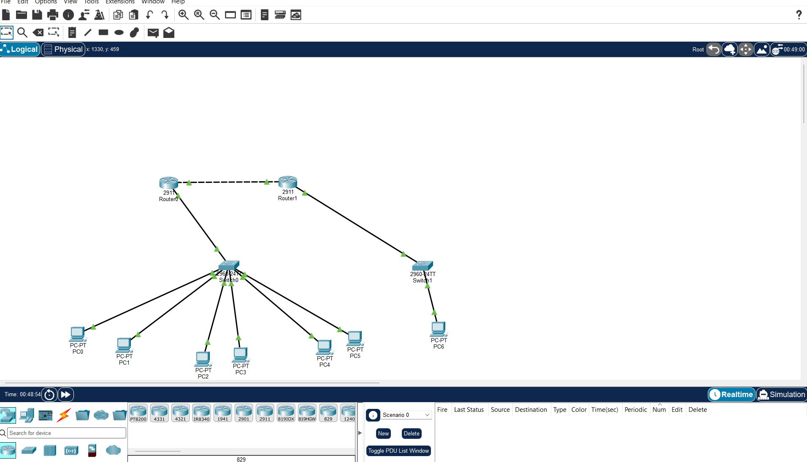

# Enterprise Network Design & Implementation

**Cisco Packet Tracer | VLANs | VLSM | DHCP | OSPF | ACLs | Network Troubleshooting**

## Project Overview

This project demonstrates the design, configuration, and verification of a simulated enterprise network connecting a headquarters office to a remote branch.

The network was built using Cisco Packet Tracer and includes departmental VLAN segmentation, inter-VLAN routing, dynamic IPv4 addressing, OSPF routing, access control policies, and structured troubleshooting.

## Network Topology

### Network Devices

- 2 Cisco 2911 Routers (R1 and R2)
- 2 Cisco 2960 Switches (SW1 and SW2)
- 7 PCs
- Headquarters with three departmental VLANs
- Remote office connected through a routed point-to-point link

## IP Addressing Scheme

| Network | Subnet | Default Gateway |
|---|---|---|
| Production — VLAN 30 | 192.168.10.0/26 | 192.168.10.1 |
| Sales — VLAN 10 | 192.168.10.64/27 | 192.168.10.65 |
| Marketing — VLAN 20 | 192.168.10.96/28 | 192.168.10.97 |
| R1–R2 WAN Link | 10.0.0.0/30 | N/A |
| Remote Office LAN | 192.168.20.0/24 | 192.168.20.1 |

## Technologies Implemented

### VLANs and 802.1Q Trunking

Three VLANs were configured on SW1 to separate Sales, Marketing, and Production traffic. An IEEE 802.1Q trunk connects SW1 to R1.

### Inter-VLAN Routing

Router-on-a-Stick was implemented on R1 using subinterfaces for each VLAN.

### DHCP

R1 provides dynamic IPv4 addresses to the headquarters workstations through separate DHCP pools.

### OSPF Dynamic Routing

OSPF Area 0 was configured between R1 and R2, enabling dynamic route exchange between headquarters and the remote office.

### Access Control Lists

An extended ACL named `SALES_POLICY` prevents Sales workstations from accessing the Production network while allowing permitted communications.

## Network Verification

The following tests were successfully performed:

| Test | Result |
|---|---|
| Router interface status | Passed |
| VLAN membership | Passed |
| 802.1Q trunk verification | Passed |
| DHCP address allocation | Passed |
| OSPF neighbor adjacency | FULL |
| OSPF routing table verification | Passed |
| Headquarters to Remote Office connectivity | Passed |
| Sales to Production restriction | Blocked as intended |
| Sales to Marketing connectivity | Passed |
| Marketing to Production connectivity | Passed |

## Troubleshooting Scenario

A simulated network incident was introduced by administratively disabling SW1 interface FastEthernet0/1, disconnecting PC0 from the network.

The issue was diagnosed using Cisco IOS commands, including:

- `show interfaces status`
- `show running-config`
- `ping`

The root cause was identified, the interface was restored using `no shutdown`, and connectivity was successfully revalidated.

## Repository Structure

- `packet-tracer/` — Cisco Packet Tracer simulation file
- `screenshots/` — Network topology, configurations, and test evidence
- `documentation/` — IP addressing, validation results, and troubleshooting notes

## Skills Demonstrated

- Enterprise network design
- IPv4 subnetting and VLSM
- VLAN configuration and trunking
- Inter-VLAN routing
- DHCP configuration
- OSPF routing
- Extended ACL implementation
- Network troubleshooting
- Cisco IOS command-line configuration
- Technical documentation

## Tools Used

Cisco Packet Tracer, Cisco IOS CLI, ICMP Ping, and Traceroute.

## Project Scope

This is an educational enterprise network simulation developed to demonstrate practical networking configuration, verification, and troubleshooting skills.

## Technical Documentation

- [IP Addressing and VLSM](documentation/ip-addressing.md)
- [Network Verification and Test Results](documentation/test-results.md)
- [Troubleshooting Incident Report](documentation/troubleshooting.md)
